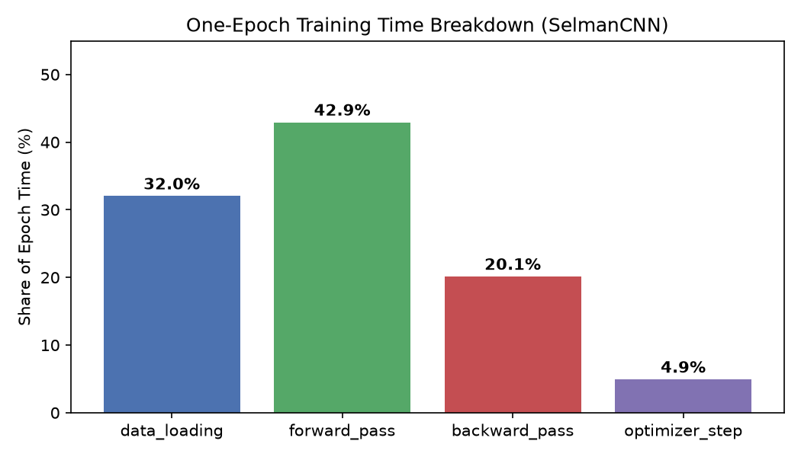
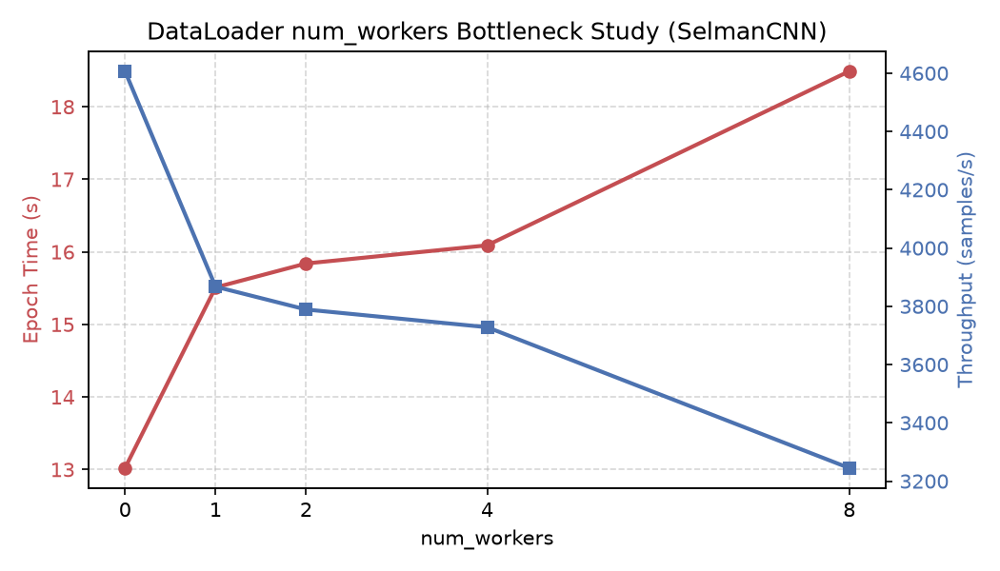
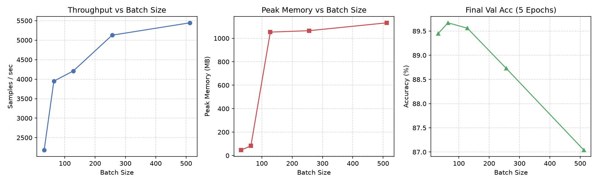
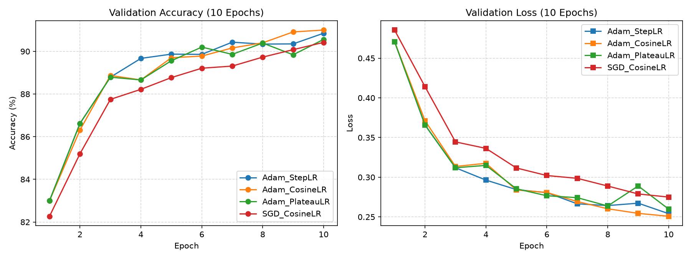
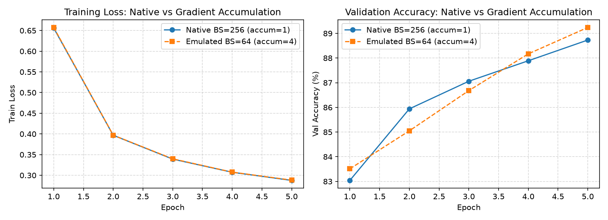

# Lab 6: Training Pipelines, Profiling, and Project Proposal

**Student:** Selman Burak Uygurtürk  
**Student ID:** 72922  
**Course:** Machine Learning [CII5SE039CI] — Group 01  
**Base Model:** `SelmanCNN` (Best model from Lab 3 — 94,858 params, 91.52% Val Acc on Fashion-MNIST)

---

## Task 1: YAML-Driven Pipeline & MLflow Tracking
Refactored `SelmanCNN` training into a reproducible pipeline (`src/train.py`) driven by `configs/base.yaml`. Includes deterministic seeding (`seed=42`), automatic MPS/CUDA/CPU device selection, per-epoch checkpointing (`checkpoints/`), and MLflow tracking of parameters, epoch metrics, YAML configs, checkpoints, and logged PyTorch models.

---

## Task 2: One-Epoch Profiling (`torch.profiler`)
| Stage | Time (ms) | Share (%) |
| :--- | :---: | :---: |
| `data_loading` | 3540.67 | 32.02% |
| `forward_pass` | 4746.62 | 42.93% |
| `backward_pass` | 2225.71 | 20.13% |
| `optimizer_step` | 544.58 | 4.92% |

**Finding:** Forward pass dominates (42.93%), partly due to the CPU fallback required for `AdaptiveAvgPool2d((3,3))` on Apple MPS, followed by data loading (32.02%).

---

## Task 3: DataLoader `num_workers` Bottleneck Study
| `num_workers` | Epoch Time (s) | Throughput (samples/s) |
| :---: | :---: | :---: |
| 0 | 13.02 | 4606.7 |
| 1 | 15.51 | 3867.3 |
| 2 | 15.84 | 3788.9 |
| 4 | 16.09 | 3728.2 |
| 8 | 18.49 | 3244.8 |

**Finding:** `num_workers=0` is fastest (4606.7 samples/s). Because Fashion-MNIST is small and memory-resident, macOS `spawn`-based worker process startup and IPC serialization overhead outweigh any parallel I/O benefit.

---

## Task 4: Batch-Size Study (5 Epochs)
| Batch Size | Throughput (samples/s) | Peak Memory (MB) | Final Val Acc (%) |
| :---: | :---: | :---: | :---: |
| 32 | 1816.4 | 46.73 | 89.45 |
| 64 | 3262.5 | 82.84 | 89.67 |
| 128 | 6186.6 | 1056.84 | 89.56 |
| 256 | 7095.9 | 1068.84 | 88.73 |
| 512 | 7462.0 | 1131.84 | 87.04 |

**Finding:** Larger batch sizes increase throughput ($4.1\times$ from BS=32 to BS=512) and GPU driver memory allocation, while reducing gradient updates per epoch—leading to lower 5-epoch accuracy at BS=256/512. BS=64–128 offers the best accuracy-throughput trade-off.

---

## Task 5: LR Schedulers & Optimizers (10 Epochs, BS=128)
| Run | Optimizer | Scheduler | Init LR | Final Val Acc (%) | Best Val Acc (%) | Final Val Loss | Total Time (s) |
| :--- | :---: | :---: | :---: | :---: | :---: | :---: | :---: |
| `Adam_StepLR` | ADAM | `StepLR` | 0.001 | 90.85 | 90.85 | 0.2541 | 141.0 |
| `Adam_CosineLR` | ADAM | `CosineAnnealingLR` | 0.001 | **91.00** | **91.00** | **0.2508** | 151.0 |
| `Adam_PlateauLR` | ADAM | `ReduceLROnPlateau` | 0.001 | 90.56 | 90.56 | 0.2598 | 107.6 |
| `SGD_CosineLR` | SGD (mom=0.9) | `CosineAnnealingLR` | 0.010 | 90.42 | 90.42 | 0.2750 | 101.3 |

**Finding:** `Adam + CosineAnnealingLR` achieved the highest accuracy (91.00%) and lowest validation loss (0.2508) under a fixed 10-epoch budget, outperforming `SGD+momentum` (90.42%), which converges slightly slower in short budgets.

---

## Task 6: Gradient Accumulation (`BS=256` vs `BS=64 x 4`)
| Epoch | Native BS=256 Train Loss | Accum 64x4 Train Loss | Native BS=256 Val Acc (%) | Accum 64x4 Val Acc (%) |
| :---: | :---: | :---: | :---: | :---: |
| 1 | 0.6560 | 0.6575 | 83.04 | 83.51 |
| 2 | 0.3968 | 0.3970 | 85.94 | 85.05 |
| 3 | 0.3391 | 0.3398 | 87.06 | 86.68 |
| 4 | 0.3073 | 0.3076 | 87.89 | 88.17 |
| 5 | 0.2876 | 0.2883 | 88.73 | 89.24 |

**Finding:** Training loss trajectories match within ~0.0007 across all 5 epochs. Minor validation differences stem from `BatchNorm2d` computing batch statistics over micro-batches of 64 rather than 256.

---

## Task 7: Checkpoint Recovery (Interrupt at Epoch 3, Resume 4